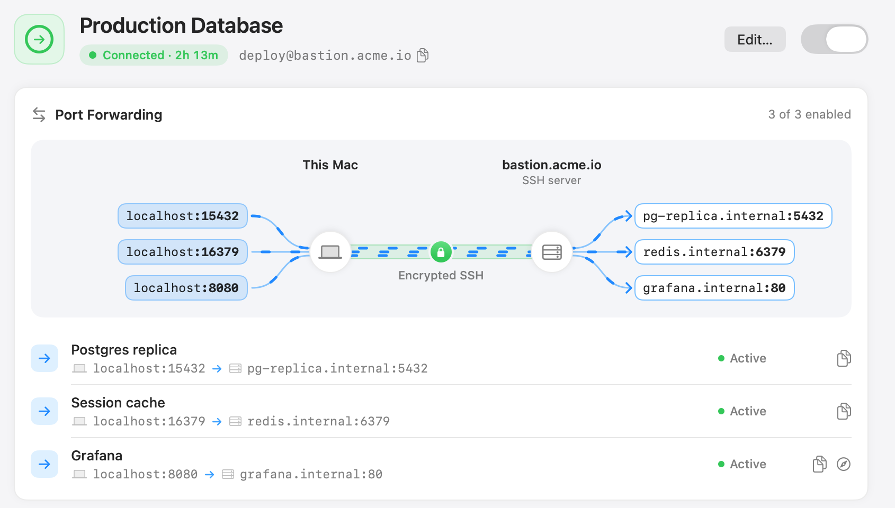
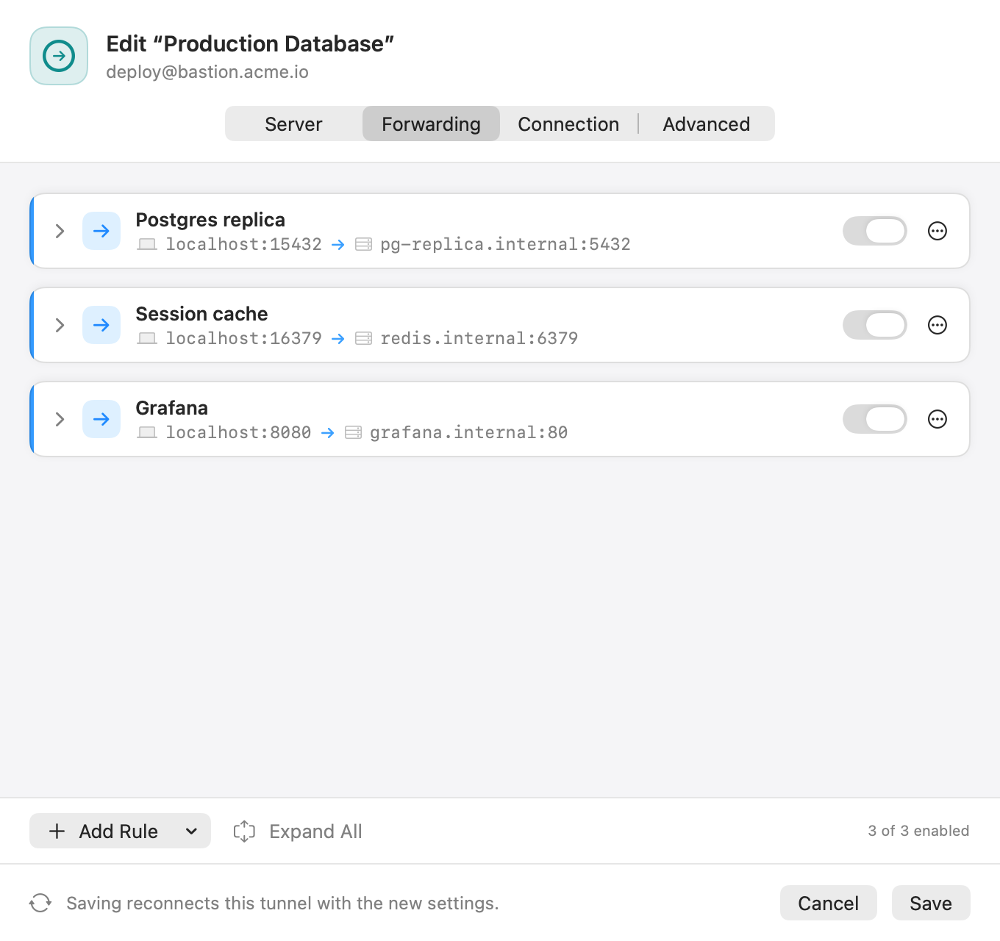
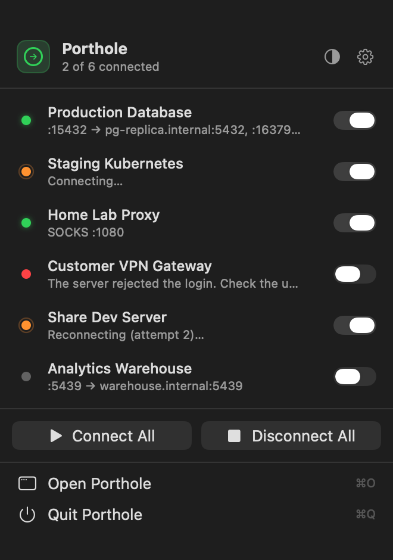
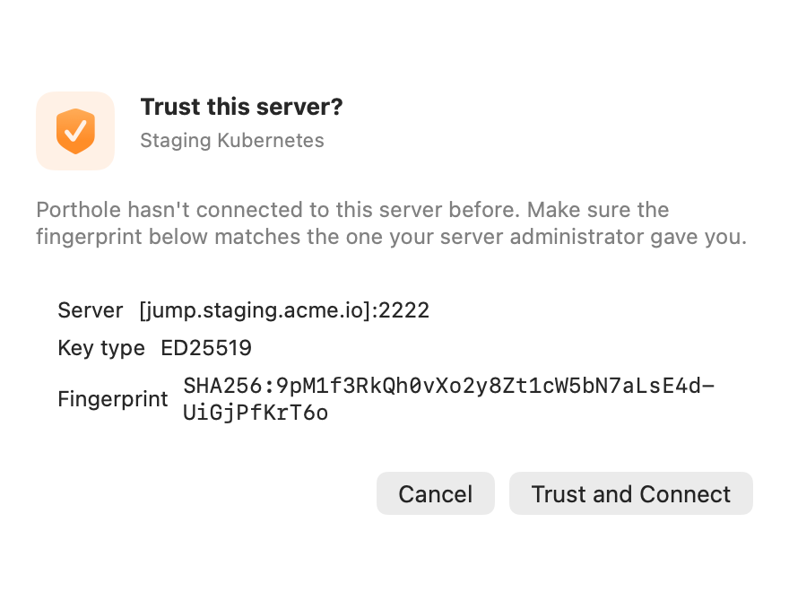
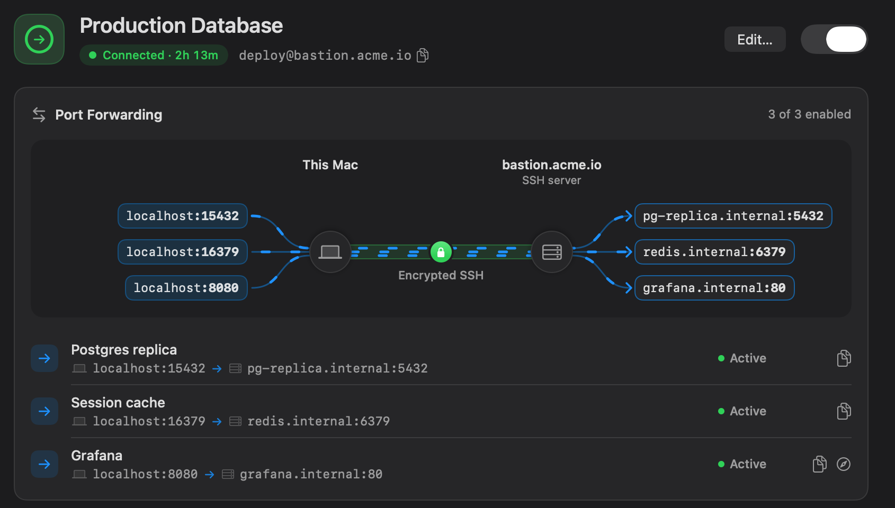
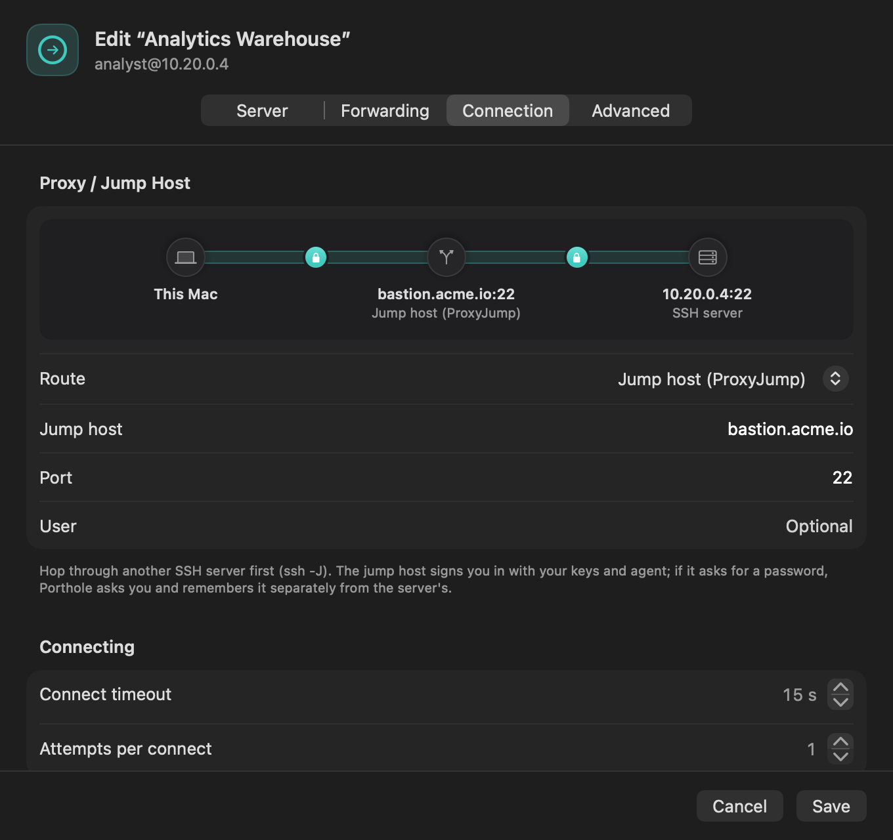
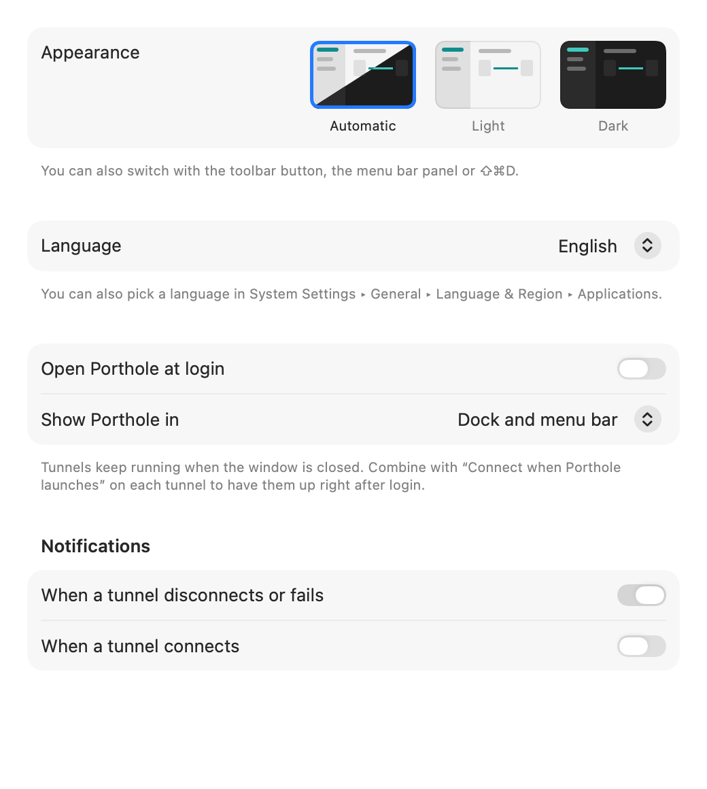

<p align="center">
  
</p>

<h1 align="center">Porthole</h1>

<p align="center">
  An SSH tunnel manager for macOS, built for Apple silicon.<br>
  Bring the databases, dashboards and internal sites behind your servers to a local port on your Mac.
</p>

<p align="center">
  <a href="https://porthole.yomahub.com/">Website</a> ·
  <a href="https://porthole.yomahub.com/#download">Download</a> ·
  <a href="https://porthole.yomahub.com/docs.html">Guide</a> ·
  <a href="README.zh-CN.md">简体中文</a>
</p>

<p align="center">
  
  
  
  <a href="LICENSE"></a>
</p>



Porthole is a modern replacement for Codinn's **SSH Tunnel**, which only ships for Intel Macs and will stop running on future versions of macOS. Porthole keeps all of its core features, adds a native SwiftUI interface, and drives the OpenSSH that comes with macOS, so security fixes arrive with system updates.

| Editing a rule | Menu bar | Confirming a fingerprint |
| --- | --- | --- |
|  |  |  |

## Features

- **Three kinds of forwarding rules**: local, remote and dynamic (SOCKS proxy), as many as you like per tunnel, with plain-language explanations and presets for common services (PostgreSQL, MySQL, Redis…).
- **Route diagram**: each tunnel is drawn as *this Mac → encrypted SSH channel → server → destination*. Colours and moving dots show every rule's state and which way the data flows, and the editor previews it as you type.
- **Sign-in**: password, private key, ssh-agent and keyboard-interactive (two-factor); reads `~/.ssh/config`.
- **Passwords stay in the Keychain**: login passwords, key passphrases and proxy and jump host passwords live only in the macOS Keychain. Neither the settings file nor exports contain a password.
- **Fingerprint checks**: the first time you connect, Porthole shows the server's fingerprint and waits for you to confirm it. A changed host key is always refused.
- **Proxies and jump hosts**: connect through a SOCKS4, SOCKS5 or HTTP proxy (with user name and password), or through a jump host (ProxyJump).
- **Reconnects on its own**: retries at 2, 4, 8, 16 and 30 second intervals, and refreshes tunnels when the network comes back or your Mac wakes.
- **Port taken? It tells you by whom**: local ports are checked before connecting; when one is in use, Porthole names the process and its PID.
- **No leftover processes**: ssh processes left behind by an unexpected quit are cleaned up at the next launch.
- **The ssh command in plain sight**: the editor previews the exact command Porthole runs and copies it for the terminal.
- **Menu bar panel**: switch tunnels one by one, or connect and disconnect them all; show Porthole in the Dock, the menu bar or both.
- **Smart groups and search**, **open at login**, **import and export** (including SSH Tunnel exports and `~/.ssh/config` hosts with forwards).
- **10 interface languages**: English, 简体中文, 繁體中文, 日本語, 한국어, Deutsch, Français, Español, Português (Brasil) and Русский.
- **Light, dark or automatic**: switch from the toolbar, the menu bar panel or with <kbd>⇧⌘D</kbd>.

| Dark mode | Through a jump host | Settings |
| --- | --- | --- |
|  |  |  |

## Install

Requires macOS 14 Sonoma or later on Apple silicon (M-series).

1. Download the zip from the [website](https://porthole.yomahub.com/#download), unzip it and drag `Porthole.app` into Applications.
2. Porthole isn't notarized by Apple yet, so macOS stops it the first time: open **System Settings ▸ Privacy & Security**, click “Open Anyway” under Security and confirm. Or remove the quarantine flag in Terminal:

   ```bash
   xattr -dr com.apple.quarantine /Applications/Porthole.app
   ```

3. Press <kbd>⌘N</kbd> to create your first tunnel. The [guide](https://porthole.yomahub.com/docs.html) walks through it step by step.

### Moving from SSH Tunnel

1. In SSH Tunnel, select all your tunnels and choose **File ▸ Export Selected Tunnels…**.
2. In Porthole, choose **File ▸ Import Tunnels…** (<kbd>⇧⌘I</kbd>) and pick that file.
3. Exports don't include passwords. Enter each one the first time you connect and tick “Remember in my Keychain”.

SSH Tunnel's export format isn't documented, so the importer reads it leniently. If an import comes out wrong, please [open an issue](https://github.com/bryan31/porthole/issues) (remove server names and other private details from the file first).

## How it works

Porthole has no SSH stack of its own. It drives the OpenSSH that ships with macOS (`/usr/bin/ssh`, native arm64, updated with the system):

- Each tunnel is one `ssh -N` process with `ExitOnForwardFailure=yes`; Porthole reads its output to track the connection and every forward.
- Passwords, key passphrases and host key confirmations come back to the app through `SSH_ASKPASS`: the same executable runs in a helper mode and talks to the app over a local Unix socket with a random token.
- For proxies, the same executable acts as the `ProxyCommand` (`--proxy-connect`) and performs the SOCKS4 / SOCKS5 / HTTP CONNECT handshake, with user name and password.
- Tunnels are stored as JSON in `~/Library/Application Support/Porthole/tunnels.json`; passwords are kept only in the macOS Keychain.

## Building from source

Only the Command Line Tools are needed (no full Xcode), on macOS 14+ with Apple silicon.

```bash
git clone https://github.com/bryan31/porthole.git
```

```bash
cd porthole && ./scripts/build-app.sh
```

This produces `build/Porthole.app` (arm64, ad-hoc signed). Add `--install` to copy it into Applications as well.

Run the unit tests (this also checks the translations):

```bash
./scripts/test.sh
```

For development:

| | |
| --- | --- |
| `PORTHOLE_DATA_FILE=/path/tunnels.json` | Use a different tunnels file and leave your real data alone |
| `PORTHOLE_DEBUG_LOG=/path/debug.log` | Mirror every tunnel log line and state change to a file |
| `Porthole --render-snapshots <dir>` | Render the main screens with sample data as PNGs |

### Translations

Translations live in `Localization/<language>.json` as `{"English source": "translation"}`; plurals are written as `{"one": "…", "few": "…", "other": "…"}`. When the app is packaged, `scripts/i18n.py compile` turns them into `.lproj/Localizable.strings` and `.stringsdict`.

After changing interface text, extract the strings again, then list missing entries and mismatched placeholders (`%@`, `%lld`) for every language:

```bash
python3 scripts/i18n.py extract
```

```bash
python3 scripts/i18n.py check
```

## Project layout

```
Sources/PortholeCore/   Pure logic: models, ssh command builder, log parser, askpass protocol, proxy handshakes, importers (unit tested)
Sources/Porthole/       The SwiftUI app: engine (processes, reconnects, Keychain), views, askpass / proxy helper modes
Tests/                  Unit tests (Swift Testing)
Localization/           Translations (JSON) and the extracted key list
scripts/                Packaging, tests, icon, translations and website release scripts
design/logo/            Icon sources (logo.py writes the SVGs)
website/                The website (static pages in 简体中文, English and 繁體中文)
deploy/                 nginx configuration for the website
```

## Contributing

[Issues](https://github.com/bryan31/porthole/issues) and pull requests are welcome. Please run `./scripts/test.sh` before sending code, and update the translations in `Localization/` when you change interface text.

## License

[MIT](LICENSE)
