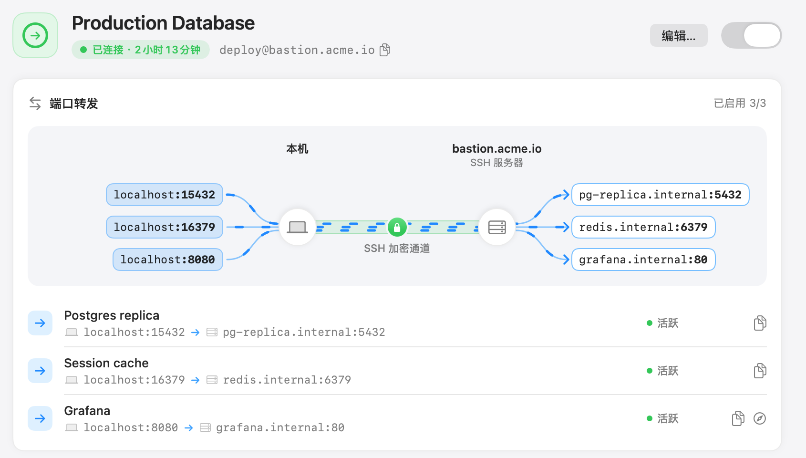
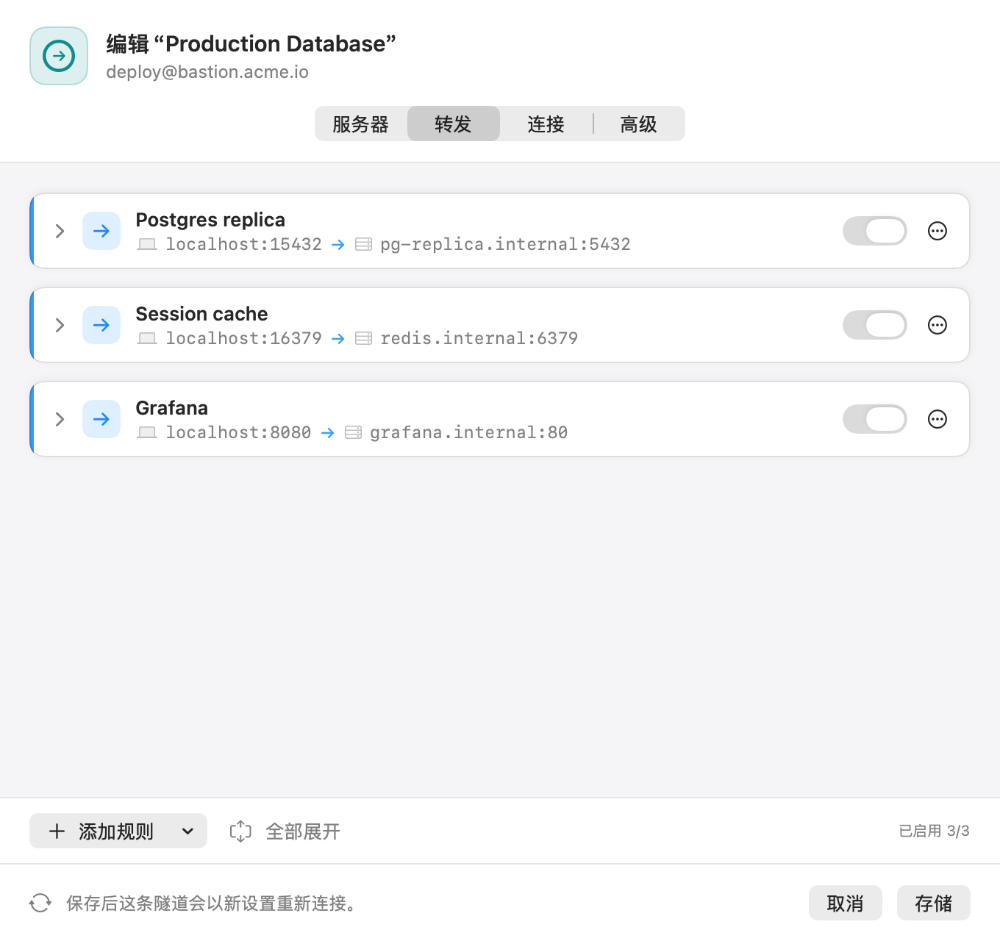
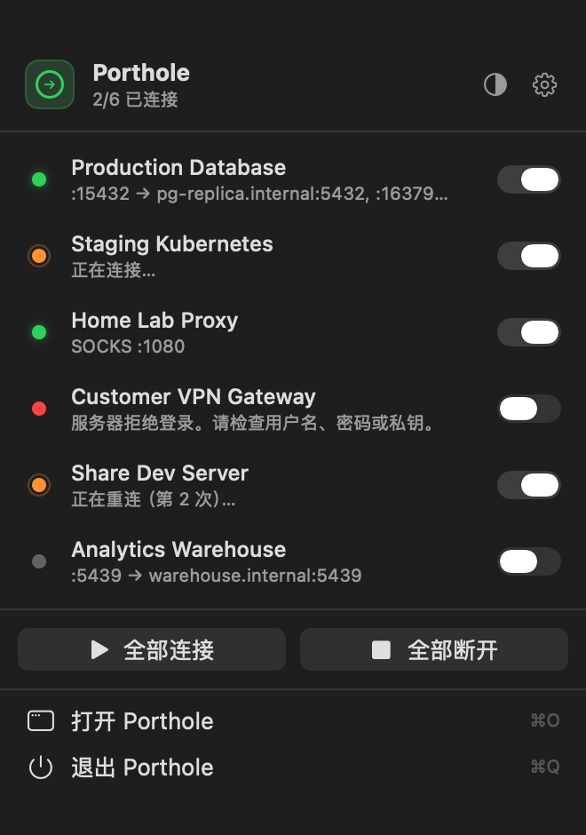
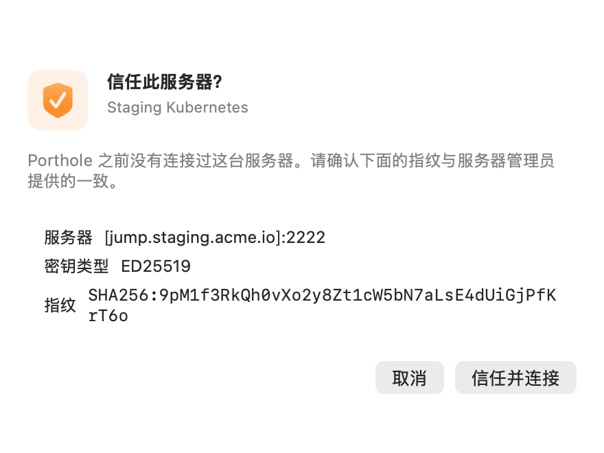
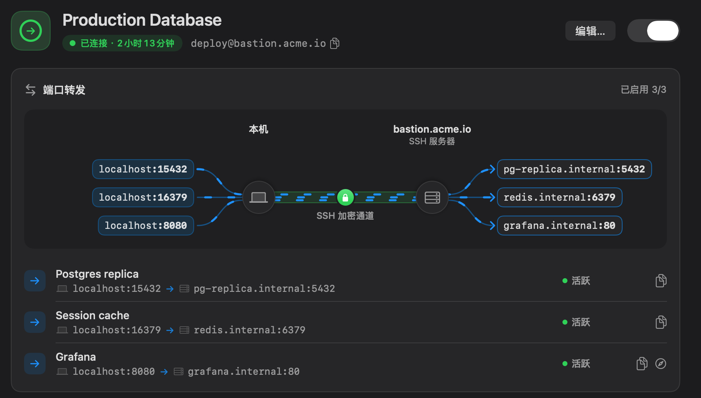
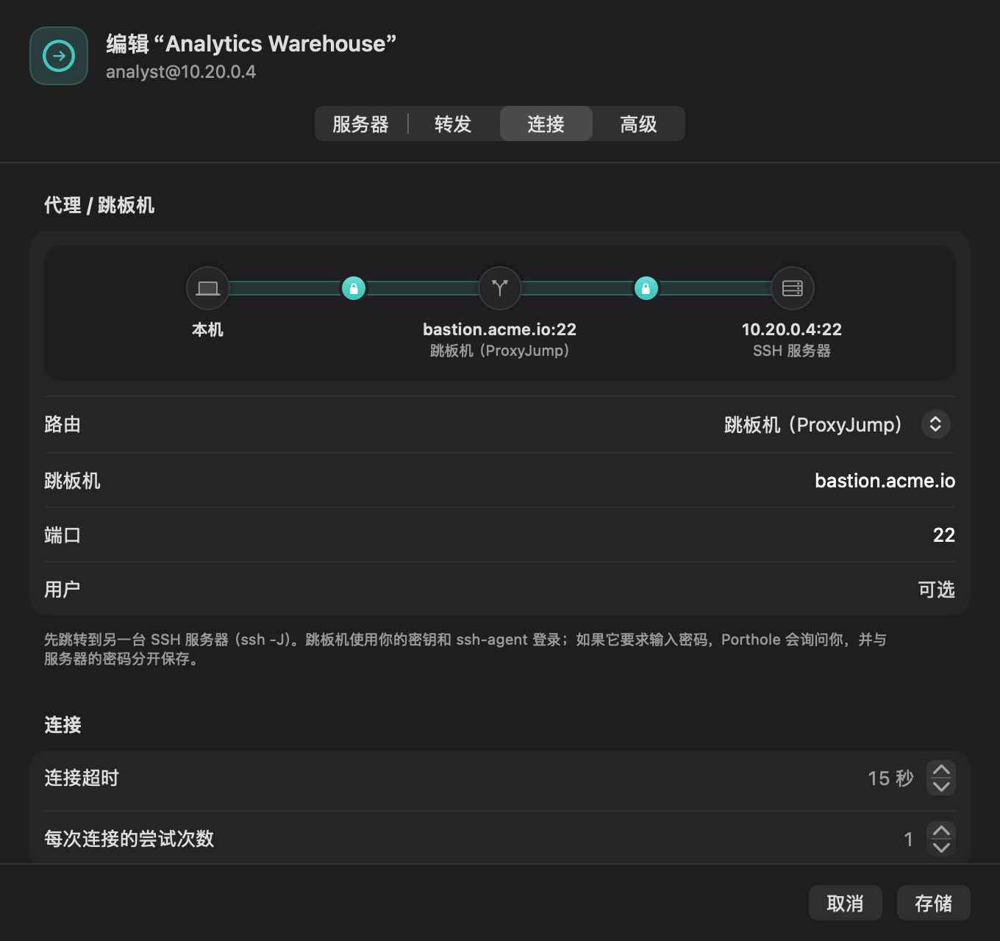
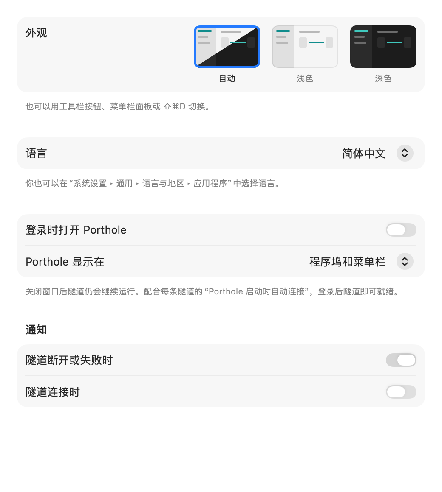

<p align="center">
  
</p>

<h1 align="center">Porthole 舷窗</h1>

<p align="center">
  为 Apple 芯片打造的 macOS SSH 隧道管理工具。<br>
  把服务器后面的数据库、监控面板和内网网站，接到你 Mac 的本地端口上。
</p>

<p align="center">
  <a href="https://porthole.yomahub.com/zh-hans/">官网</a> ·
  <a href="https://porthole.yomahub.com/zh-hans/#download">下载</a> ·
  <a href="https://porthole.yomahub.com/zh-hans/docs.html">使用说明</a> ·
  <a href="README.md">English</a>
</p>

<p align="center">
  
  
  
  <a href="LICENSE"></a>
</p>



Porthole 是 Codinn **SSH Tunnel** 的现代替代品：原版只有 Intel 版本，在后续 macOS 中将无法运行。Porthole 保留了它的全部核心功能，换上了原生 SwiftUI 界面，并且直接驱动 macOS 自带的 OpenSSH，跟着系统一起获得安全更新。

> Porthole = Port（端口）+ hole（通道）。舷窗是船上通向外面的圆窗，也就是图标的样子。

| 编辑转发规则 | 菜单栏 | 服务器指纹确认 |
| --- | --- | --- |
|  |  |  |

## 功能

- **三种转发规则**：本地、远程、动态（SOCKS 代理），一条隧道里可以放多条规则；配有白话解释和常用预设（PostgreSQL、MySQL、Redis…）。
- **路线图示**：每条隧道画成“本机 → SSH 加密通道 → 服务器 → 目标”，颜色和流动的光点实时显示每条规则的状态与数据方向；编辑时同步预览。
- **登录方式**：密码、私钥、ssh-agent、键盘交互（双重认证）；读取 `~/.ssh/config`。
- **密码只在钥匙串里**：登录密码、私钥口令、代理和跳板机密码都只存在 macOS 钥匙串，配置文件和导出文件里没有密码。
- **服务器指纹**：首次连接显示指纹并由你确认，主机密钥变化时一律拒绝连接。
- **代理与跳板机**：经 SOCKS4 / SOCKS5 / HTTP 代理（可带用户名密码）或跳板机（ProxyJump）连接。
- **自动重连**：断线后按 2、4、8、16、30 秒递增间隔重试；网络恢复、Mac 唤醒后自动刷新隧道。
- **端口占用检查**：连接前检查本地端口，被占用时直接告诉你是哪个进程（含 PID）。
- **不留残余进程**：意外退出后残留的 ssh 进程，下次启动时自动清理。
- **完整 ssh 命令预览**：编辑时实时预览实际执行的命令，一键拷贝到终端。
- **菜单栏面板**：逐个开关隧道、全部连接 / 全部断开；可选显示在 Dock、菜单栏或两者。
- **智能分组与搜索**、**开机启动**、**导入导出**（包括原版 SSH Tunnel 的导出文件和 `~/.ssh/config` 里带转发的主机）。
- **10 种界面语言**：English、简体中文、繁體中文、日本語、한국어、Deutsch、Français、Español、Português (Brasil)、Русский。
- **浅色 / 深色 / 自动**：工具栏按钮、菜单栏面板或 <kbd>⇧⌘D</kbd> 随时切换。

| 深色模式 | 经跳板机连接 | 设置 |
| --- | --- | --- |
|  |  |  |

## 安装

需要 macOS 14 Sonoma 或更新版本，Apple 芯片（M 系列）。

1. 从[官网](https://porthole.yomahub.com/zh-hans/#download)下载 zip，解压后把 `Porthole.app` 拖进“应用程序”文件夹。
2. Porthole 还没有经过 Apple 公证，第一次打开时 macOS 会拦下它：打开 **系统设置 ▸ 隐私与安全性**，在“安全性”一栏点“仍要打开”并确认。也可以在终端里移除隔离标记：

   ```bash
   xattr -dr com.apple.quarantine /Applications/Porthole.app
   ```

3. 按 <kbd>⌘N</kbd> 创建第一条隧道。详细步骤见[使用说明](https://porthole.yomahub.com/zh-hans/docs.html)。

### 从 SSH Tunnel 迁移

1. 在旧版 SSH Tunnel 里全选隧道，选择 **File ▸ Export Selected Tunnels…** 导出。
2. 在 Porthole 里选择 **文件 ▸ 导入隧道…**（<kbd>⇧⌘I</kbd>）导入该文件。
3. 导出文件不含密码，第一次连接时输入一次，勾选“保存到我的钥匙串”即可。

原版导出文件的格式没有公开文档，导入器做了宽松解析。如果导入结果不对，欢迎[提交 Issue](https://github.com/bryan31/porthole/issues)（请先删掉文件里的服务器地址等敏感信息）。

## 工作原理

Porthole 不自带 SSH 协议栈，而是驱动 macOS 自带的 OpenSSH（`/usr/bin/ssh`，原生 arm64，随系统更新）：

- 每条隧道是一个 `ssh -N` 进程，带 `ExitOnForwardFailure=yes`；Porthole 解析它的输出来判断连接和每条转发的状态。
- 密码、私钥口令、主机指纹确认通过 `SSH_ASKPASS` 回调到应用里：同一个可执行文件以助手模式运行，经本地 Unix socket + 随机令牌通信。
- 经代理连接时，同一个可执行文件以 `--proxy-connect` 模式充当 `ProxyCommand`，完成 SOCKS4 / SOCKS5 / HTTP CONNECT 握手（支持用户名密码）。
- 隧道配置存为 JSON：`~/Library/Application Support/Porthole/tunnels.json`；所有密码只存在 macOS 钥匙串里。

## 从源码构建

只需要 Command Line Tools（不需要完整 Xcode），macOS 14+，Apple 芯片。

```bash
git clone https://github.com/bryan31/porthole.git
```

```bash
cd porthole && ./scripts/build-app.sh
```

生成 `build/Porthole.app`（arm64，ad-hoc 签名）。加上 `--install` 会同时复制到“应用程序”文件夹。

运行单元测试（同时检查翻译）：

```bash
./scripts/test.sh
```

开发调试用的环境变量和参数：

| | |
| --- | --- |
| `PORTHOLE_DATA_FILE=/path/tunnels.json` | 使用另一份隧道配置，不影响真实数据 |
| `PORTHOLE_DEBUG_LOG=/path/debug.log` | 把所有隧道日志和状态变化同步写到文件 |
| `Porthole --render-snapshots <目录>` | 用示例数据把主要界面渲染成 PNG |

### 翻译

翻译文件在 `Localization/<语言>.json`，格式是 `{"英文原文": "译文"}`，复数写成 `{"one": "…", "few": "…", "other": "…"}`。打包时 `scripts/i18n.py compile` 把它们编译成 `.lproj/Localizable.strings` 和 `.stringsdict`。

改了界面文字以后，先重新提取，再检查各语言缺少的条目和不一致的占位符（`%@`、`%lld`）：

```bash
python3 scripts/i18n.py extract
```

```bash
python3 scripts/i18n.py check
```

## 目录结构

```
Sources/PortholeCore/   纯逻辑：数据模型、ssh 命令生成、日志解析、askpass 协议、代理握手、导入器（有单元测试）
Sources/Porthole/       SwiftUI 应用：引擎（进程管理、重连、钥匙串）、界面、askpass / 代理助手模式
Tests/                  单元测试（Swift Testing）
Localization/           各语言翻译（JSON）和提取出的键列表
scripts/                打包、测试、图标、翻译、官网发布脚本
design/logo/            图标源文件（logo.py 生成 SVG）
website/                官网（纯静态页面：简体、English、繁體）
deploy/                 官网的 nginx 配置
```

## 参与贡献

欢迎提交 [Issue](https://github.com/bryan31/porthole/issues) 和 Pull Request。提交代码前请运行 `./scripts/test.sh`；改动界面文字时请同步更新 `Localization/` 下的翻译。

## 许可证

[MIT](LICENSE)
